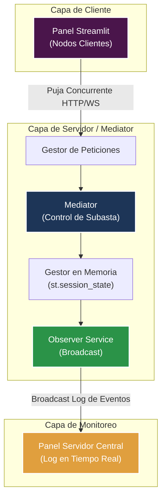
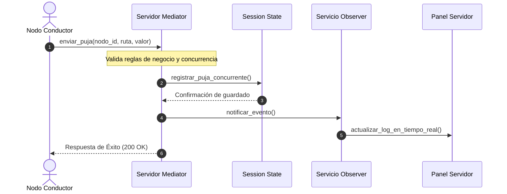

# 🚛 ValleFlet: Arquitectura Distribuida para Fletes P2P

> **Simulador interactivo bajo patrones de diseño (Mediator y Observer) para la gestión concurrente de nodos y cargas en el Valle del Cauca.**

---

## 📌 Tabla de Contenidos
- [Acerca del Proyecto](#-acerca-del-proyecto)
- [Integrantes del Equipo](#-integrantes-del-equipo)
- [Stack Tecnológico](#-stack-tecnológico)
- [Arquitectura y Patrones de Diseño](#-arquitectura-y-patrones-de-diseño)
- [Requisitos Previos](#-requisitos-previos)
- [Instalación y Ejecución](#-instalación-y-ejecución)
- [Guía de Uso del Prototipo](#-guía-de-uso-del-prototipo)
- [Modelado UML](#-modelado-uml)
- [Licencia](#-licencia)

---

## 🔍 Acerca del Proyecto

**ValleFlet** es un sistema distribuido diseñado para optimizar la asignación y subasta de fletes en el corredor logístico del departamento del Valle del Cauca (Cali, Yumbo, Jamundí, Buenaventura, Palmira). 

La plataforma soluciona la ineficiencia y la alta latencia en la intermediación tradicional de cargas mediante una arquitectura distribuida híbrida. El sistema utiliza un **Servidor Centralizador (Mediator)** para administrar y validar las peticiones concurrentes de los transportistas, junto con un **Servicio de Notificación (Observer)** que propaga los eventos en tiempo real a todos los nodos conectados.

---

## 👥 Integrantes del Equipo

* **Guillermo Alirio Camacho Jaramillo** – *Arquitecto de Software y Líder Técnico*
* **Diego Fernando Ramirez Gomez** – *Desarrollador Frontend y Especialista en Prototipado*
* **Brayan Acosta** – *Ingeniero de Pruebas, Modelado y Documentación*

---

## 🛠️ Stack Tecnológico

* **Lenguaje:** Python 3.12+
* **Interfaz y Reactividad:** Streamlit
* **Entorno de Ejecución recomendado:** WSL2 (Windows Subsystem for Linux) con Ubuntu / Linux POSIX
* **Control de Concurrencia:** Hilos independientes (`threading`) y estado global en memoria (`st.session_state`)

---

## 📐 Arquitectura y Patrones de Diseño

El proyecto implementa dos patrones de diseño estructurales/comportamentales clave:

1. **Patrón Mediator (Mediador):** 
   - Centraliza la comunicación entre nodos evitando acoplamientos de red de tipo $O(N^2)$.
   - Procesa, valida y ordena de forma atómica todas las pujas concurrentes entrantes.

2. **Patrón Observer (Observador / Broadcast):**
   - Garantiza una arquitectura basada en eventos (*event-driven*).
   - Cuando se aprueba una puja, el servidor notifica automáticamente a los observadores suscritos, actualizando los logs del sistema en tiempo real.

---

## 📋 Requisitos Previos

Antes de comenzar, asegúrate de tener instalado:
* **Python 3.10+** (Recomendado Python 3.12)
* **Git**
* Entorno **WSL2 Ubuntu** (opcional, pero recomendado para ejecución en Linux)

---

## 🚀 Instalación y Ejecución

Sigue estos pasos para clonar y ejecutar la aplicación en tu entorno local:

### 1. Clonar el Repositorio
```bash
git clone https://github.com/TU_USUARIO/ValleFlet-Distribuido.git
cd ValleFlet-Distribuido
```

### 2. Crear y Activar Entorno Virtual (Opcional pero recomendado)
```bash
python3 -m venv venv
source venv/bin/activate  # En Linux/WSL
# En Windows Cmd: venv\Scripts\activate
```

### 3. Instalar Dependencias
```bash
pip install --upgrade pip
pip install streamlit
```

### 4. Ejecutar la Aplicación
```bash
streamlit run app.py
```

Una vez ejecutado el comando, abre tu navegador en el enlace local proporcionado:
```text
http://localhost:8501
```

---

## 🖥️ Guía de Uso del Prototipo

La interfaz está dividida en tres pestañas principales:

1. **🖥️ Nodo Servidor Central (Mediator):**
   - Muestra el estado global de la red (número de nodos activos y pujas procesadas).
   - Muestra el **Log de Eventos en Tiempo Real (Broadcast)** actualizado mediante el patrón Observer.
   - Cuenta con el botón **"🔄 Refrescar Estado"** para sincronizar la vista.

2. **📱 Nodos Clientes (Conductores):**
   - Simula las terminales de transporte de los conductores (ej. `Nodo_Conductor_01`, `Nodo_Conductor_02`).
   - Permite seleccionar la ruta de flete disponible en el Valle del Cauca y enviar pujas concurrentes.
   - Al pulsar **"⚡ Enviar Puja Concurrente"**, la petición se procesa en la sección crítica del servidor.

3. **📐 Arquitectura y UML:**
   - Muestra un resumen rápido de los patrones integrados y la justificación técnica del proyecto.

---

## 📊 Modelado UML

### Diagrama de Componentes (Mermaid)


### Diagrama de Secuencia (Flujo de Puja)


---

## 📄 Licencia

Este proyecto fue desarrollado con fines educativos para la asignatura de **Arquitectura de Software**. Todos los derechos reservados © 2026 ValleFlet Team.